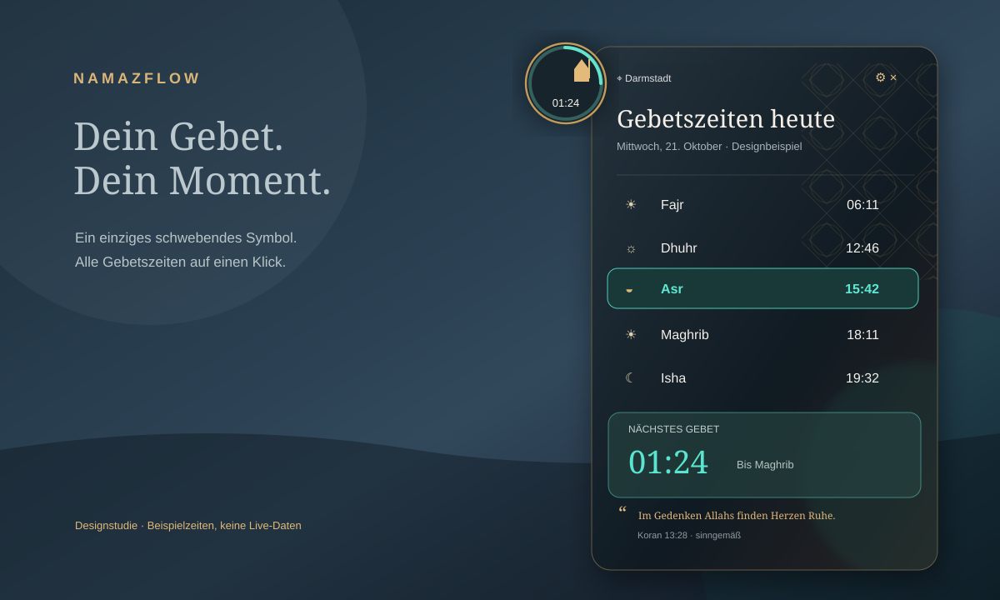

# NamazFlow

A calm, elegant **floating prayer-times companion for Windows 10/11**, inspired by an approved dark-glass, gold-and-teal desktop concept.

> **Status:** v0.1 initial implementation / visual QA candidate. The illustration shows **demonstration values**, not actual prayer times. Never use the concept graphic to plan prayers.

## Features

- A single draggable floating orb, always on top, with an elegant progress ring and live countdown.
- Click to expand into an ornamental translucent panel with **Fajr, Dhuhr, Asr, Maghrib and Isha**, today's Gregorian/Hijri dates and a reminder.
- Current-prayer highlighting, tomorrow's Fajr after Isha, and DST-aware countdowns.
- Crisp drawn vector symbols, individual editable prayer icons, floating-icon style, three themes.
- City/country, calculation method (Diyanet, MWL, ISNA, Umm Al-Qura, etc.) and Hanafi/standard Asr.
- System tray, optional autostart, optional prayer-start notifications, locally saved settings.
- Validated cached days for offline use **without inventing times**. If current-day data is unavailable, display a warning.

## Installation (development)

Requires **Python 3.10+**, Windows 10 or 11.

~~~powershell
git clone https://github.com/EHWASALES/NamazFlow.git
cd NamazFlow
py -m venv .venv
.venv\Scripts\Activate.ps1
pip install -r requirements.txt
python main.py
~~~

For a packaged executable, use the **Windows build** artifact from GitHub Actions once the workflow succeeds.

## Controls

- **Click orb** to open/close the panel; **drag orb** to move it.
- **Gear** opens settings, **×** collapses the panel, **pencil** changes that prayer's icon.
- **Click a prayer row** for a short reminder.
- **Right-click** the orb or tray icon for settings, update and exit.
- The widget stores configuration under %APPDATA%\NamazFlow on Windows.

## Calculation and reliability

Times are fetched from the [AlAdhan Prayer Times API](https://aladhan.com/prayer-times-api) for the configured **city, country, method and Asr school**. They can differ from your local mosque/DITIB timetable. Configure the method and verify local differences. Yesterday, today and tomorrow are loaded on a background thread. Validated replies are cached per date and method. If the service fails, **only previously validated cached data** is displayed with an offline indication; missing values stay blank.

Network use: city/country are sent to AlAdhan. No ads, tracking, analytics, account, GPS access or API key.

## Tests

~~~bash
pip install -r requirements-dev.txt
pytest -q
# On a machine with a Qt platform:
python scripts/visual_audit.py --strict
~~~

CI tests logic on Linux/Windows, renders Qt offscreen, captures three reproducible screenshot stages and publishes PNG/JSON artifacts.

## Visual quality and concept parity

- Reference: the approved image in the original ChatGPT project conversation. A vector concept is included as docs/namazflow-concept.svg.
- Targets: elevated translucent dark panel, compact moon/mosque orb, gold Islamic-inspired linework, teal progress/accent, readable typography, five prayer rows and a countdown.
- Three-stage QA: orb, expanded glass panel, custom-symbol variant. Generated by scripts/visual_audit.py.
- Optional palette comparison with approved screenshot: python scripts/visual_audit.py --reference-image path/to/concept.png. This is not a pixel-perfect similarity score.
- Human review on a **real Windows 11 desktop at 100% and 150% scaling** is required before declaring production readiness.

Read docs/quality-review.md for limitations and acceptance criteria.

## Packaging

CI publishes an unsigned Windows executable. Tagged builds v* trigger a Windows setup via PyInstaller and Inno Setup. Without code signing, Windows SmartScreen may show a warning. Managed machines should respect their security policy.

## License

No open-source license is granted yet. Copyright belongs to the repository owner.
